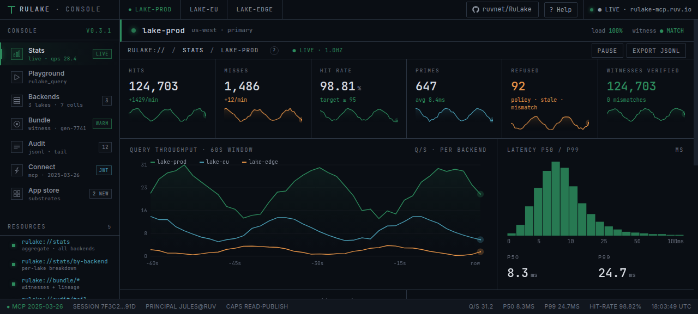

# ruLake — A Memory Lake for Agentic AI

<a href="https://ruvnet.github.io/RuLake/lakes/">
  <picture>
    <source media="(prefers-reduced-motion: reduce)" srcset="assets/lake-snapshot-flow.svg#still" />
    
  </picture>
</a>

> **[Try the live Console →](https://ruvnet.github.io/RuLake/)** — boots in DEMO, auto-probes the hosted MCP at [`rulake-mcp.ruv.io`](https://rulake-mcp.ruv.io/), flips to `● LIVE` when the wire's up. Eight tools served, zero install.

[](https://crates.io/crates/rulake)
[](https://www.rust-lang.org)
[](https://github.com/ruvnet/ruvector)
[](https://ruv.io)
[](#license)

[](https://rulake-mcp.ruv.io/)
[](https://rvdna-mcp.ruv.io/)
[](https://ruqu-mcp.ruv.io/)

<details>
<summary>Preview the RuLake console</summary>

<a href="https://ruvnet.github.io/RuLake/"></a>

</details>

### Self-learning memory for your AI agents — without standing up a vector database.

ruLake caches vector snapshots and attaches a witness to each generation. The stock MCP server serves in-memory collections and local `ruvec1` files. Export embeddings from BigQuery, Snowflake, Athena on S3, Delta Lake, Iceberg or Microsoft Fabric and prepare them locally. Rust applications can also register Parquet on Google Cloud Storage through the GCS adapter. Cached searches run on the host. Warehouse exports, storage and transfer have their usual provider costs.

[**Try a sample search or import your lake →**](https://ruvnet.github.io/RuLake/lakes/) · [BigQuery export recipe](https://ruvnet.github.io/RuLake/lakes/#bigquery) · [Measured cache performance](BENCHMARK.md)

> Created by [rUv](https://ruv.io). Part of the [RuVector](https://github.com/ruvnet/ruvector) ecosystem alongside [`ruvector-rabitq`](https://github.com/ruvnet/ruvector/tree/main/crates/ruvector-rabitq) (1-bit compression kernel) and RVF (durable segment format). Powered by [Cognitum](https://cognitum.one).

## Quick start

```bash
# Five install paths. Pick the one that fits where your agent runs.
cargo add rulake                      # Rust
pip   install rulake                  # Python
npm   install rulake                  # Node.js / TypeScript (native binary)
npm   install rulake-wasm             # Browsers, Cloudflare Workers, Deno, Bun
```

```text
# Claude Code, Cursor, Cline — install the marketplace (ADR-009)
/plugin marketplace add ruvnet/RuLake
/plugin install rulake-stack@rulake-marketplace
/reload-plugins                                  # required — Claude Code's install message asks for this

# Slash commands resolve via <plugin>:<command>. Type /ru to autocomplete.
/rulake-stack:rulake-query "what does ADR-157 commit to?"
/rulake-stack:rulake-verify path/to/table.rulake.json
/rulake-stack:rulake-bundle-info path/to/table.rulake.json
```

`rulake-stack` is the killer-path install. To use the namespaced form `/rulake-core:*`, `/rulake-witness:*`, or `/rulake-kernels:*`, install those plugins separately (`/plugin install <name>@rulake-marketplace`).

### Console startup

<a href="https://github.com/ruvnet/RuLake/pull/25">
  <picture>
    <source media="(prefers-reduced-motion: reduce)" srcset="assets/console-startup.svg#still" />
    
  </picture>
</a>

Measured across five cold loads per build in Chrome on ruOS with 80 ms simulated latency and 10 Mbps throughput. [Benchmark details](https://github.com/ruvnet/RuLake/pull/25)

### Claude Code integration — at a glance

| | Feature | What it does |
|---|---|---|
| ⚡ | **One-command install** | `/plugin install rulake-stack@rulake-marketplace` — no API keys, no config files, nothing to set up |
| 🚀 | **Working in under a minute** | Type four lines, get a real query result with a receipt back |
| 🔌 | **Three free demo servers built in** | Talks to `rulake-mcp.ruv.io`, `rvdna-mcp.ruv.io`, `ruqu-mcp.ruv.io` out of the box |
| 🎯 | **18 ready-to-use tools** | 8 retrieval (search / verify / explain / refresh) + 5 genomic + 5 quantum |
| 🛡️ | **Cryptographic receipt on every answer** | Each result is fingerprinted; tampered or stale data is rejected, not served |
| 📊 | **A decision trace with every answer** | The agent sees how it was made: what it cost, where it came from, how long it took, what was refused |
| 🔬 | **Verify an answer without the network** | `/rulake-stack:rulake-verify path/to/bundle.json` — runs locally, no server needed |
| 🧬 | **Genomic memory built in** | Find variants, score sequences, trace lineage, translate to protein — five tools |
| ⚛️ | **Quantum simulation built in** | Run circuits, verify results, replay history, optimize, schedule error-correction — five tools |
| ⚙️ | **Optional speed-ups for big workloads** | Plug in CPU vector instructions or GPU shaders when you need them; fall back to plain CPU when you don't |
| 🏗️ | **Six plugins, mix and match** | `stack` (all-in-one) plus `core`, `substrates`, `kernels`, `witness`, `loop-vector` for finer control |
| 💸 | **Free forever, $0 per query** | MIT or Apache-2.0; no service to pay for, no per-query metering, no API key |

Six-plugin catalog + trust posture: see [ADR-009](docs/adrs/sdk/ADR-009-rulake-plugin-marketplace.md). For the bare `npm install rulake-wasm` path on edge runtimes (browsers, Cloudflare Workers, Deno, Bun), see the install paths above.

## Where to next

- **[USERGUIDE.md](USERGUIDE.md)** — full README content moved here: architecture, performance, capabilities (35 features), backends, kernels, security model, examples, status, comparisons.
- **[`docs/userguide/`](docs/userguide/)** — screen-by-screen Console walkthrough with all 7 screenshots. 11 markdown files covering Stats / App Store / Connect / Backends / Bundle / Playground / Audit + Live MCP setup + Troubleshooting.
- **[`docs/gists/`](docs/gists/)** — 11 deep gists, ~34k words. One per shipped ADR.
- **[`docs/deploy/cloud-run.md`](docs/deploy/cloud-run.md)** — production deploy recipe (the one that powers `https://rulake-mcp.ruv.io/`).
- **[ADR-009](docs/adrs/sdk/ADR-009-rulake-plugin-marketplace.md)** — the Claude Code plugin marketplace shape + trust posture.

## License

Licensed under either of [Apache License, Version 2.0](LICENSE-APACHE) or [MIT license](LICENSE-MIT) at your option. Open source. ❤️ Free forever.
