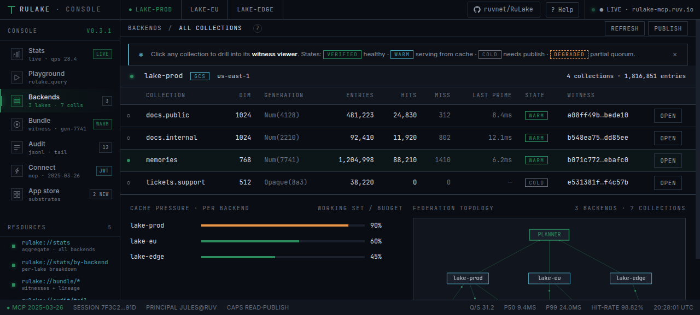

# 05 — Backends and collections

The Backends route is where you browse what the connected MCP exposes. In
demo mode it shows three fixture backends; in `● LIVE` mode it calls the
real `rulake_list_backends` tool, then `rulake_list_collections` per
backend, and renders whatever comes back.



## Import warehouse or lake data

The [data sources guide](https://ruvnet.github.io/RuLake/lakes/) includes export recipes, the Parquet and JSON importer, a local search and a stock MCP configuration. Start with the [BigQuery recipe](https://ruvnet.github.io/RuLake/lakes/#bigquery) or choose your source. Each filesystem collection represents the export you selected. Publish a new snapshot to pick up later source changes.

## What a "backend" is

A backend is a Rust struct that implements the `BackendAdapter` trait from
`crates/core/src/backend.rs`. The trait is four required methods plus one
optional:

```rust
pub trait BackendAdapter: Send + Sync {
    fn id(&self) -> &str;
    fn list_collections(&self) -> Result<Vec<CollectionId>>;
    fn pull_vectors(&self, collection: &str) -> Result<PulledBatch>;
    fn generation(&self, collection: &str) -> Result<u64>;
    fn current_bundle(&self, collection: &str)
        -> Result<Option<RuLakeBundle>> { Ok(None) }
}
```

Today the repo ships:

| Crate | Adapter | Purpose |
|---|---|---|
| `crates/core/` | `LocalBackend` | In-memory reference impl |
| `crates/core/` | `FsBackend` | `ruvec1` binary on disk; mtime as generation |
| `crates/gcs-backend/` | `GcsBackend` | Parquet on Google Cloud Storage |
| `crates/ipfs-backend/` | `IpfsBackend` | `table.rulake.json` over kubo/gateway |
| `crates/rvdna-backend/` | T0/T1/T2 tiered | `.rvdna` v2 genomic files |
| `crates/ruqu-backend/` | StateVector / Stabilizer / TensorNetwork / hardware-stub | Quantum sim collections |

Adding your own is the four methods above. Once registered with
`RuLake::add_backend`, every Console screen — federation graph, witness
chain, audit tail — renders it without any further plumbing.

## What a "collection" is

A collection is a named set of vectors inside one backend, addressed as
`(backend_id, collection_id)`. The Console treats the pair as the primary
key for everything: cache pointer, bundle witness, audit row target,
publish target.

A fixture row in the demo table carries:

| Column | Meaning |
|---|---|
| `Collection` | id (e.g. `memories`, `docs.public`) |
| `Dim` | vector dimensionality |
| `Generation` | `Num(N)` (numeric, monotonic) or `Opaque(<bytes>)` (CA hash) |
| `Entries` | vector count in the cached snapshot |
| `Hits` / `Miss` | per-collection counters since last reset |
| `Last prime` | most recent cold-prime cost in ms |
| `State` | `WARM` / `COLD` / `DEGRADED` (see below) |
| `Witness` | first 16 hex of the SHAKE-256(32) bundle witness |

## State tags

The four colour-coded tags carry a precise meaning:

- **`VERIFIED`** (green) — internal health flag for the row, set when the
  most recent witness check passed.
- **`WARM`** — cache entry is live, serving searches without a backend
  round-trip.
- **`COLD`** — registered but never primed. First search will pull
  vectors from the backend.
- **`DEGRADED`** — cache entry exists but the most recent coherence check
  found the backend's generation drifted past the freshness budget. Search
  works under `Eventual` consistency; refuses under `Fresh`.

## Toolbar — Refresh and Publish

**Refresh** issues two MCP calls:

```
rulake_list_backends         → ["lake-prod", "lake-eu", ...]
rulake_list_collections {b}  → ["memories", "docs.public", ...]   per backend
```

The audit tail gains a `LIST_COLLECTIONS_OK` row on success or
`LIST_COLLECTIONS_FAILED` on error. Live inventory loads when you enter the view or connect a server. Up to four collection lists are fetched concurrently. Empty and failed listings are shown explicitly. **Read bundle** requests the selected collection’s MCP resource.

In demo mode, **Publish** records a simulated action for the selected fixture in the local audit log.

## Cache pressure (per backend)

The lower-left card shows working-set / budget as a percentage bar per
backend. Bars turn amber above 85%. The demo illustrates these percentages. Live inventory displays only fields returned by the server.

## Federation topology

In demo mode the lower-right card is a small canvas-rendered graph showing the
planner → backends → collections fan-out, with a moving particle along
each edge to indicate live request flow. Coloured dots:

- green = `WARM`
- amber = `DEGRADED`
- grey = `COLD`

The graph is read-only; click a row in the table above to drill into a
specific collection's bundle.

## Drilling into a row

Click any row to select it (a green dot fills in the leftmost column).
Click the **Open** button at the right end of the row to jump to the
[06 — Bundle / witness viewer](./06-bundle-witness-viewer.md) for that
`(backend, collection)`.

## Working entirely off-wire

In demo mode the table renders three backends:
- `lake-prod` (gcs, 4 collections)
- `lake-eu` (fs, 2 collections)
- `lake-edge` (ipfs, 1 collection)

The fixture data is in `ui/src/lib/data.js` under `BACKENDS`. It exists so
the screen reads usefully when the demo MCP is unreachable. None of these
fixture rows are wired to a live backend — refresh has no effect on them.
